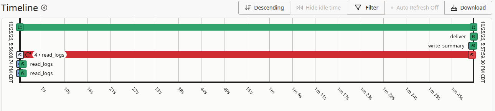

# Night Shift

[](https://github.com/pyaroslav/night-shift/actions/workflows/tests.yml)


**Night Shift reads your Oracle alert and listener logs overnight and leaves a two-line brief for the morning.** It runs on your own machine: Gemma 4 on Ollama writes the brief, and a Temporal workflow makes sure it arrives.

I built it because my lab database died on a Tuesday afternoon and I found out on Sunday night.

```
# Night Shift

> lab-26ai has an out of space tablespace; lab-se2 is down; lab-offsite logs are unreadable.
> Start lab-se2 and review its logs from before it stopped.

## lab-26ai: up
2026-10-24 22:56 to 2026-10-25 22:56 UTC · 302 log lines, 262 routine

- 🔴 Out of space in a tablespace (ORA-01653), 2026-10-25 22:47 UTC. Add or extend a datafile, or find what grew.
- 🟡 Checkpoint not complete, 37× 2026-10-25 01:00 UTC → 2026-10-25 21:06 UTC. Redo logs are too small or too few for the load.
- 🟡 Deadlocks (ORA-00060), 2026-10-25 22:47 UTC. Read the trace file: it names both sessions and the SQL.

## lab-se2: DOWN
- 🔴 Database is not running now. no pmon process for ORCLCDB; last alert log entry 2026-10-20 18:39 UTC

## lab-offsite: not checked
- 🔴 Couldn't read the logs. No such container: ns-offsite-gone
```

## How it works

1. **Rules sort the night** ([`nightshift/logs.py`](nightshift/logs.py)). Alert log entries (12c+ and 11g timestamps) and listener lines are matched against about twenty plain patterns: instance terminations, ORA-600, corruption, a stuck archiver, a full tablespace, deadlocks, failed jobs, and so on. Repeats are folded together: one outage that writes four lines counts as one, and a job that fails every ten minutes is one finding with a count. Routine lines (log switches, resizes, scheduler windows) are counted, never reported. Any ORA- code that matches no rule still shows up as "Other Oracle error", so a new problem can't vanish.
   For a deadlock (ORA-00060), it opens the trace file the alert log points to and reads the deadlock graph. TX held and wanted in X mode means two sessions updated the same rows in opposite order; TM usually means an unindexed foreign key; share-mode waits point at duplicate-key inserts or bitmap indexes. The brief then names each session's user and SQL. Client machine and program names stay out.
2. **The quiet is checked too** ([`nightshift/collect.py`](nightshift/collect.py)). Is pmon running (`ora_pmon_SID` up to 21c, `db_pmon_SID` from 23ai on)? Did the alert log write anything all night? A database that crashed on Tuesday writes nothing on Wednesday, so silence is a finding.
3. **Gemma writes two lines** ([`nightshift/brief.py`](nightshift/brief.py)). It gets a small JSON digest (about 500 characters a night; the whole prompt is about 1,200), not the log. Its answer is checked: exactly two lines, every number has to be in the digest, and every database with a critical finding has to be named. It gets three tries, and then a plain template takes over. The list under the two lines comes straight from the rules, so the model can't drop an outage from it.
4. **Temporal delivers it** ([`nightshift/flow.py`](nightshift/flow.py)). Each database is read in its own activity, with retries (15 s, 30 s, 60 s). A host that stays unreachable becomes a "Couldn't read the logs" finding instead of a crash. If the worker dies halfway, the run continues where it stopped when the worker comes back. If Ollama is down all night, the template writes the brief. A Temporal Schedule starts it every morning. [`tests/test_flow.py`](tests/test_flow.py) checks the unreachable-host and model-down paths on Temporal's time-skipping test server.



## Run it

You need Python 3.10+, [Ollama](https://ollama.com) with `gemma4:e4b`, and access to the logs (Docker containers, or files on this machine).

```bash
pip install -e .
ollama pull gemma4:e4b
cp targets.example.json targets.json      # your databases

night-shift now                            # one brief right now, no Temporal
night-shift server                         # local Temporal: one binary, a SQLite file, UI on :8233
night-shift worker                         # leave it running
night-shift schedule --at 06:00 --tz America/Chicago
night-shift run                            # one night through Temporal, now
```

To keep the server and worker running across reboots, [`contrib/`](contrib) has two systemd user units. If the machine is asleep at 6 AM, the Schedule's catch-up window starts the missed run when it wakes up.

`night-shift server` looks for the Temporal CLI in `.temporal-bin/` or on your PATH. The Python SDK can download it for you: `python -c "import asyncio; from temporalio.testing import WorkflowEnvironment as W; asyncio.run(W.start_local(download_dest_dir='.temporal-bin'))"`.

A target is a container (read with `docker exec`, so nothing gets installed next to the database) or plain files:

```json
{"name": "lab-se2", "container": "w2-se2", "sid": "ORCLCDB",
 "alert": "/opt/oracle/diag/rdbms/orclcdb/ORCLCDB/trace/alert_ORCLCDB.log",
 "listener": "/opt/oracle/diag/tnslsnr/*/listener/trace/listener.log",
 "mute": ["ORA\\$AT_OS_OPT_SY_"]}
```

`mute` takes regexes for things you've decided to live with. That one is the Statistics Advisor job that fails every ten minutes on a fresh 12.2 CDB. Night Shift only reads the logs. It never connects to the database or writes to it.

## Does the brief say what matters?

[`lab/replay.py`](lab/replay.py) replays 22 nights from two lab databases (Oracle 26ai Free and 12.2 SE2, Oct 13 to the evening of Oct 25): the 24 hours to 6 AM Central. It compares Night Shift with pasting the same night's raw alert log into the same model, using the same two-line instructions. The events that must be reported are found with plain grep on the raw log, independent of the rules: an instance died, a tablespace filled, a deadlock, a missing online redo log, or an alert log silent all night. The test is whether **the two lines** say them, because those are what you read at 7 AM.

| gemma4:e4b, 22 nights | Night Shift | Raw log, same model |
|---|---|---|
| Must-report events named in the two lines | **7 / 8** | 6 / 8 |
| Kept to two lines | **21 / 21** | 17 / 21 (4 essays) |
| Nights with numbers not in the log | **0** | 7 (4 of them wrong counts) |
| What the model reads | ~1,200 characters | up to 1.7 M characters (cut to 90 K) |

- **The raw log is good on small nights.** On the night lab-se2 died, it named the cause (MMAN died, PMON error 822) better than Night Shift's line did.
- **On big nights it stops following instructions.** It wrote multi-page essays on the four nights that didn't fit the context, and on one of them the night's only deadlock was in the part that got cut, so it never saw it. It can't see that a log is silent, because there's nothing to send.
- **It counts wrong.** Four times it gave the number of log switches in a night, and all four were wrong: 54 (actually 61), 33 (69), 87 (58), 45 (77). The other three nights' numbers are rounded file sizes converted from KB, values from SQL it wrote itself, and the next log sequence after the window.
- **Night Shift's miss:** on lab-se2's first night, the two lines named the outage, the missing redo log and 17 job failures, but not the 2 deadlocks. They're in the list below the two lines.
- **Honest caveats.**
  - These are lab nights, and the events are few: 2 instance terminations (a `shutdown abort` during setup on Oct 13, and the real crash on Oct 20), 3 nights with deadlocks, 1 full tablespace I caused on purpose, and 1 silent night.
  - I changed the prompt once after the first replay (it skipped deadlocks and quoted the digest's field names). That run is in `results/replay-v1.json`: 6/8. I also loosened one scoring pattern from "silent" to "silen" after Gemma wrote "alert log silence", which gave Night Shift one of its 7.
  - A rerun with the final code, which adds the restart rule, scored 8/8 (`results/replay-v3.json`). The two lines vary a little from run to run, so the table keeps the lower number.
  - The four biggest nights didn't fit the 32K-token context I asked for, and Ollama cut them down to about 16K tokens. A bigger context would help the raw approach on those nights, at a cost in time and memory.

```bash
.venv/bin/python lab/replay.py samples results/replay-v1.json > results/replay.json
.venv/bin/python lab/score.py results/replay.json
```

## Why local and open

Alert logs carry host names, file paths, user names and SQL. A DBA can't paste a client's into a hosted chatbot, and doesn't want a SaaS agent with a login to production. Night Shift is one Python package, a small open model (Gemma 4 E4B) and a single Temporal binary with a SQLite file, all on one machine. It costs nothing per night. When the model is wrong, you can see why (the digest is right there) and change the rules.

## License

MIT
